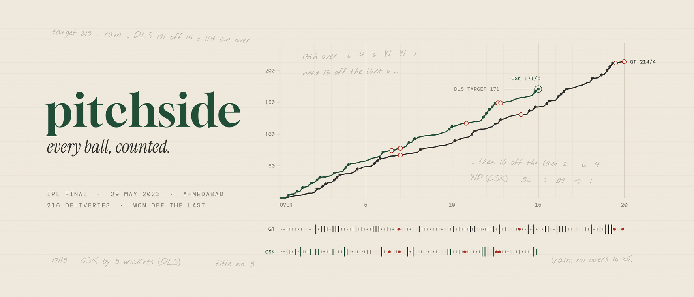

<p align="center"></p>

# pitchside

[](https://github.com/naveenpiedy/pitchside/actions/workflows/tests.yml)

A local cricket analytics engine. It loads [Cricsheet](https://cricsheet.org) ball-by-ball data into DuckDB, one database per competition, and answers questions about it: splits, comparisons, leaderboards, team and venue profiles, **net stats** (performance against what an average player would have done on the same balls), small-sample-aware rankings, win probability and match impact.

Everything is computed on your machine. An AI client (Claude, Cursor, anything that speaks MCP) can drive it through tools that return small, finished tables, so the model reasons over answers instead of raw data.

The IPL (2008–2026, 1,243 matches) is loaded today; other T20 competitions are a config entry away.

---

## Quick start

Requires [uv](https://docs.astral.sh/uv/) (it installs Python 3.12 and the dependencies).

```bash
uv sync                              # install
uv run pitchside load ipl            # download Cricsheet's IPL zip, build db/ipl.duckdb (~5 s)
uv run pitchside register            # player register (names, ids) -> db/registry.duckdb
uv run pitchside attributes fetch    # batting hand / bowling style for every player (Wikipedia)
uv run pitchside info                # what's loaded
```

Data and databases are not in the repository (`data/` and `db/` are gitignored); these commands rebuild them. On Windows, if player names print as garbled characters, set `PYTHONIOENCODING=utf-8`.

`attributes fetch` classifies about 89% of players automatically. The rest, mostly recent uncapped players, need batting hand / bowling style typed into `data/player_attributes.csv` (see [Player attributes](#player-attributes)); `uv run pitchside attributes missing` lists them by how much they matter.

---

## A ten-minute tour

Each command prints a small table. Names can be partial (`Kohli`), codes work for teams (`RCB`, `KXIP`), and `-f key=value` filters anything.

**A player**

```bash
uv run pitchside player "SA Yadav" -f season=2023+
```

Overall line, archetype, then splits by season, phase, pace vs spin, bowling subtype, position, entry point, setting vs chasing, and net stats by season and phase.

**Any split, any filters**

```bash
uv run pitchside splits Kohli --by bowl_type,phase -f season=2024+
uv run pitchside splits "SA Yadav" --by entry_bucket -f season=2023+
uv run pitchside compare "SA Yadav" Klaasen Pooran -f bowl_type=spin -f season=2024+
```

**Net stats**: actual, expected (an average player on the same balls), difference

```bash
uv run pitchside net Kohli --by season -f season=2022+
uv run pitchside net Bumrah -r bowling --by phase -f season=2023+
```

**Leaderboards**: any metric, any filters; `*_shrunk` metrics handle small samples

```bash
uv run pitchside leaders net_sr -f season=2026 --min-balls 200
uv run pitchside leaders net_sr_shrunk -f season=2026
uv run pitchside leaders net_economy_shrunk -f phase=death -f season=2025+
uv run pitchside leaders runs --per season -n 1
```

**Who wins matches**: win probability added

```bash
uv run pitchside mvp -f season=2026 -n 10
uv run pitchside mvp -f season=2025 -f stage=playoffs -n 5
uv run pitchside impact 1426312          # the 2024 final: win % by over, who swung it
```

**Before a match**: one brief with head to head, form, venue, phase profiles, key players and matchups

```bash
uv run pitchside brief CSK MI --venue Wankhede
uv run pitchside brief RCB PBKS --venue Ahmedabad -f season=2025+
```

**Teams and grounds**

```bash
uv run pitchside team RCB -f season=2024+
uv run pitchside h2h CSK MI
uv run pitchside venue Chepauk -f season=2023+
uv run pitchside team-rank run_rate --side bowling -f phase=death -f season=2026
```

**Player types**

```bash
uv run pitchside archetypes -f season=2024+ --summary
uv run pitchside archetypes -r bowling -a "death" -f season=2024+
```

**A scorecard**

```bash
uv run pitchside scorecard ipl 1426312 --partnerships
```

`uv run pitchside filters` lists every filter key, split dimension and metric.

---

## Concepts

The short version is below; [docs/METHODS.md](docs/METHODS.md) has every formula, what slice of data each piece is estimated on, and worked examples with real numbers.

### Filters, dimensions, metrics

Every analysis takes the same filters, as `-f key=value` on the command line or a JSON object in AI tools:

| Kind | Keys |
|---|---|
| When | `season` (`2024`, `2022-2025`, `2020+`), `date`, `competition`, `stage` (league/playoffs) |
| Where in the innings | `phase` (powerplay/middle/death), `over` (`16-20`), `innings` (setting/chasing), `wickets_down`, `nth_ball` (the batter's nth ball, e.g. `1-5`) |
| Entry point | `entry_phase` (opener/powerplay/middle/death), `entry_over`, `entry_wickets` |
| Who | `team`, `opposition` (names, old names or codes), `bowler`, `batter` (head-to-head), `position` |
| Bowling / batting style | `bowl_type` (pace/spin), `bowl_subtype` (RF RFM RMF RM LF LFM LMF LM OB LB SLA LWS), `bowling_arm`, `batting_hand` |
| Where | `venue`, `city` |

Lists use commas (`bowl_subtype=OB,LB`). Splits group by dimensions (`--by season,phase`): the filter keys plus `ball_bucket`, `entry_bucket`, `required_rate`, `order_group`, `player`, `bowler`, `batter`, `team_name`.

Results flag small samples (`low` under 30 balls, `small` under 120) and are cached until new data arrives.

### Net stats

Raw numbers mislead because of when players bat and bowl: a 150 strike rate is excellent in the middle overs and ordinary at the death. Net stats compare every ball with what an average player in the same competition would produce in the same situation:

- the competition's scoring level for that **over in that season** (so 2010 and 2026 are each judged against their own era),
- adjusted for **wickets down**, **setting vs chasing** and, in a chase, the **required rate**,
- and for how **settled the batter is** (balls 1–5, 6–10, 11+ at the crease), so late arrivals aren't judged against set batters,
- with the adjustments estimated separately per **rules era** (`rule_eras` in `tournaments.toml`; the IPL changes in 2023 with the Impact Player rule).

Positive is always better than average, and every net stat sums to zero across the league. Each comes with its expectation (`exp_*`) so you can see both.

| Batting | Bowling |
|---|---|
| `net_sr`, `net_avg`, `net_runs`, `outs_saved`, `net_dot_pct`, `net_boundary_pct` | `net_economy`, `runs_saved`, `net_wickets`, `net_avg`, `net_sr`, `net_dot_pct`, `net_boundary_pct` |

`uv run pitchside baselines ipl -t bat_runs -p death` shows the adjustment factors.

**Runs added** (`runs_added`, `runs_added_per_100`, `wicket_runs`) puts scoring and survival in one number: net runs plus every dismissal priced at what losing a wicket then costs the batting side (about 10 runs in the powerplay, 2 at the death), from a Duckworth–Lewis style run-production curve fitted per competition and rules era. For bowlers, their wickets earn the same price. It's the "Impact" of Himanish Ganjoo's primer, built on pitchside's own expectations.

### Small samples (`*_shrunk`)

A 30-ball hot streak shouldn't top a leaderboard. Every rate has a shrunk version that pulls a player towards the average (under the same filters) by *k* balls of prior evidence, with *k* estimated from the data for each rate: about 160 balls for net strike rate, but over 1,000 for wicket-taking, which is mostly noise in T20. Use them to rank players with uneven samples: `strike_rate_shrunk`, `average_shrunk`, `net_sr_shrunk`, `net_avg_shrunk`, `economy_shrunk`, `net_economy_shrunk`, `net_wickets_shrunk`, and more.

### Win probability and WPA

Two models per competition (first innings and chase), fitted on its own history, give each side's chance of winning before every ball. A ball's **WPA** (win probability added) is the change it causes, in wins: batters earn it on balls they face, bowlers the opposite on balls they bowl. `wpa` and `wpa_per_match` work as metrics everywhere; `mvp` and `impact` summarise them. Net stats measure efficiency; WPA measures effect on results.

Over the last four overs of a chase, the chase model hands over to a ball-by-ball model. A smooth curve treats "2 off 1" as a required rate only a little above par and said 0.92; ball-by-ball, it's mostly a dot or a single, and the IPL chases that faced it scored about 0.6 (a tie counting half). The ball-by-ball model works backwards from the last ball, using per-ball outcome chances (dots, runs, extras, wickets) for that many wickets in hand, runs needed per ball and balls left, era and ground. `uv run pitchside winprob ipl` shows the model and how well calibrated it is, including the last 12 balls of chases.

### Archetypes

Rule-based labels, shown with the numbers behind them:

- **Batters**: Powerplay enforcer, Anchor opener, Opener, Top-order aggressor / anchor / accumulator, Middle-overs aggressor, Middle-order anchor / accumulator, Finisher, Lower-order hitter / batter.
- **Bowlers**: New-ball seamer, Middle-overs seamer, Death specialist, All-phase seamer, Powerplay / Middle-overs / Death-overs spinner, tagged *(economical)* or *(expensive)*.

The thresholds are constants in `src/pitchside/stats/archetypes.py`.

### Names

Player names resolve by exact name, then a clear favourite by activity, then known aliases (`Rashid` → Rashid Khan, `Virat Kohli` → V Kohli); ambiguous names (`Pandya`) list the candidates, and `uv run pitchside find <name>` shows ids. Teams and grounds with several names are unified in `aliases.toml`: renamed franchises count as one under their current name (Delhi Daredevils seasons are Delhi Capitals), and codes like `RCB` or `KXIP` work anywhere a team is expected.

---

## Using it from an AI (MCP)

`pitchside-mcp` is an MCP server (stdio). The AI calls tools; the engine computes locally and returns compact tables.

- **Claude Code**: `.mcp.json` in this folder registers it; approve it when prompted.
- **Claude Desktop / other clients**: add to the client's MCP config, with this folder's path:

```json
{
  "mcpServers": {
    "pitchside": {
      "command": "uv",
      "args": ["--directory", "/path/to/pitchside", "run", "pitchside-mcp"]
    }
  }
}
```

**Things to ask it**

- *Who were the best death bowlers in IPL 2025, adjusted for situation and sample size?*
- *Compare Suryakumar Yadav and Heinrich Klaasen against spin since 2023.*
- *Brief me on CSK v MI at the Wankhede: who are the key players and matchups?*
- *Which batters do best when walking in during overs 7–10?*
- *How did the 2024 IPL final swing, and who won it for KKR?*
- *What's the par first-innings score at the Chinnaswamy recently, and do teams chase there?*
- *Is Kohli an anchor? Show his net strike rate by phase over the last three seasons.*

**Tools**

| Group | Tools |
|---|---|
| Discovery | `overview`, `grammar`, `describe_schema`, `find_player`, `find_team`, `find_venue`, `find_matches` |
| Players | `player_profile`, `player_splits`, `net_stats`, `compare_players`, `leaderboard`, `archetypes` |
| Teams and matches | `prematch_brief`, `team_profile`, `head_to_head`, `venue_profile`, `team_ranking`, `scorecard`, `mvp`, `match_impact` |
| SQL | `query` (one read-only SELECT, 50 rows by default), `export` (full result to `data/exports/`, only the path comes back) |
| Scratch | `scratch_save`, `scratch_list`, `scratch_drop`: named tables that persist across calls, readable from `query` as `scratch.<name>` |
| Data | `sync`: pull new matches |

The SQL tools can't touch the filesystem or change anything; each call opens and closes the databases, so loads and syncs can run while a client is connected.

---

## Keeping it current

```bash
uv run pitchside sync                          # new matches for "ongoing" competitions, then quality checks
uv run pitchside check                         # data-quality checks on demand
uv run pitchside schedule install --at 09:00   # daily sync via Windows Task Scheduler (no admin)
uv run pitchside schedule status
uv run pitchside schedule remove
```

`schedule` is **Windows only** (it registers a Task Scheduler job). `sync` itself works everywhere; on Linux or macOS, run it daily from cron (or launchd), for example:

```bash
0 9 * * * cd /path/to/pitchside && uv run pitchside sync >> data/logs/sync.log 2>&1
```

`sync` downloads Cricsheet's recently-added matches (or a competition's full archive if it hasn't synced for 25+ days), loads only matches from tracked competitions (re-running is harmless; corrected matches are replaced), rebuilds everything derived, fetches attributes for new players and runs the quality checks. The scheduled job logs to `data/logs/sync.log` and runs late if the PC was off. Competitions marked `status = "ended"` are never re-synced.

Quality checks fail if totals don't reconcile (innings vs deliveries, scorecards vs totals), chase targets are wrong, limits are broken or net-stat baselines aren't zero-sum; they warn about umpire-miscounted overs, new team or venue names (add them to `aliases.toml`) and players missing attributes.

---

## Adding a competition

Add an entry to `tournaments.toml`, using the competition's download name from [cricsheet.org/downloads](https://cricsheet.org/downloads):

```toml
[bbl]
name = "Big Bash League"
cricsheet = "bbl_male"          # downloads/bbl_male_json.zip
event = "Big Bash League"       # info.event.name in the match files
format = "T20"
status = "ongoing"              # or "ended"
rule_eras = [2021]              # optional: seasons where playing conditions changed
```

Then `uv run pitchside load bbl`, `uv run pitchside attributes fetch`, and check `uv run pitchside check bbl` for new names. Each competition gets its own database and its own baselines; tools work across all loaded competitions unless you pass `-c bbl`.

---

## Player attributes

Cricsheet doesn't record batting hand or bowling style. `attributes fetch` gets them from Wikipedia (via each player's Cricinfo id and Wikidata) into `data/player_attributes.csv`. To fill a gap or correct a row, edit the CSV, set `source` to `manual` (a later fetch never overwrites manual rows), then:

```bash
uv run pitchside attributes reload
uv run pitchside attributes missing
```

The CSV is local only (gitignored); keep a copy if you've filled rows by hand.

---

## Command reference

| Command | What it does |
|---|---|
| `load <comp>` / `register` / `attributes fetch\|reload\|missing` | Build the data |
| `info`, `find <name>`, `filters` | What's loaded, name lookup, filter/metric reference |
| `player`, `splits`, `net`, `compare`, `leaders`, `archetypes` | Player analysis |
| `brief`, `team`, `h2h`, `venue`, `team-rank` | Pre-match brief, team and ground analysis |
| `mvp`, `impact <match_id>`, `scorecard <comp> <match_id>` | Impact and matches |
| `sync`, `check`, `schedule install\|status\|remove` | Keeping data current |
| `rebuild <comp>`, `baselines <comp>`, `winprob <comp>` | Models: recompute and inspect |
| `mcp`, `scratch list\|drop`, `cache clear` | AI server and housekeeping |

Every command has `--help`.

---

## Limitations

- **T20 only** for now; ODI support needs its own baselines.
- **No ball-tracking data**: Cricsheet has no line, length or speed, so net stats know the situation but not the quality of each delivery.
- **Wicket-taking is noisy**: shrunk net wickets show little separation between bowlers in a season, which is a property of T20 data, not a bug.
- **WPA credits batters and bowlers only**: fielding isn't credited, and a run-out is charged to the striker on that ball.
- **Late-chase win probability reads low when needing 2–3 a ball** (by about 0.08 with 2–12 balls left): the ball-by-ball model treats balls as independent, so it misses hitting streaks.
- **Win probability doesn't know who is batting**: it uses wickets in hand, not the quality of the batters at the crease.
- **Bowling style is one label per career**: players who changed style (seam to spin) aren't modelled.
- **Washouts without a ball bowled** aren't in Cricsheet, so a few seasons have fewer matches than scheduled.

---

## Development

```bash
uv run pytest                       # unit tests + IPL integration tests (skipped if IPL isn't loaded)
```

GitHub Actions ([`.github/workflows/tests.yml`](.github/workflows/tests.yml)) runs the test suite on Ubuntu and Windows for every push to `master` and every pull request. CI has no Cricsheet data, so the IPL integration tests skip there: run `uv run pytest` locally with IPL loaded before merging changes to parsing, baselines or win probability.

- `src/pitchside/etl/` — download, parse, load, sync, quality checks, attributes, schedule
- `src/pitchside/model/` — schema, derived tables, net-stat baselines, shrinkage priors, win probability
- `src/pitchside/engine.py` — query engine over every loaded competition
- `src/pitchside/stats/` — filters, splits/aggregation, players, teams, archetypes, impact, scorecards
- `src/pitchside/tools.py`, `mcp_server.py` — AI tools and the MCP server
- `AGENTS.md` — conventions and invariants for anyone (or any AI) changing the code

---

## Data and licence

- Match data: [Cricsheet](https://cricsheet.org), released under the [Open Data Commons Attribution License](https://opendatacommons.org/licenses/by/1-0/). pitchside downloads it to your machine and doesn't redistribute it; anything you publish from it (tables, charts, blog posts) should credit Cricsheet.
- Batting hand and bowling style: [Wikipedia](https://www.wikipedia.org) infoboxes (text under [CC BY-SA 4.0](https://creativecommons.org/licenses/by-sa/4.0/)), found via [Wikidata](https://www.wikidata.org) and each player's Cricinfo id in Cricsheet's people register. Fetched to a local CSV, not redistributed.
- Ideas: net stats are inspired by the "true stats" of Jarrod Kimber and Good Areas. Himanish Ganjoo's [T20 Metrics: A Primer](https://hganjoo.github.io/t20basics/) gave two of them: conditioning the chase baseline on the target (the required-rate factor), and pricing wickets in runs with a Duckworth–Lewis style curve (runs added, his "Impact"). The models here are pitchside's own.
- Code: [MIT](LICENSE).
